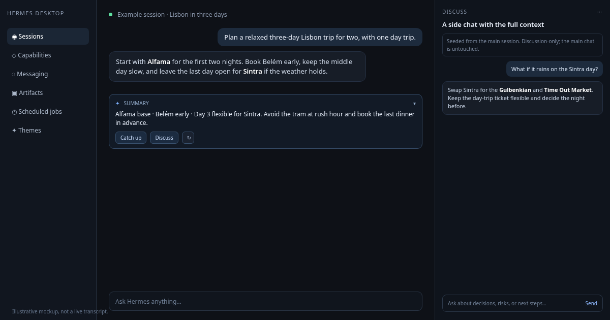

# Answer Summary

Answer Summary is a Hermes Desktop plugin for long conversations. It keeps the latest answer short, turns the whole session into a catch-up brief, and lets you open a focused side discussion without disturbing the main chat.



## What it does

- **Reply summary.** A compact AI recap of the latest assistant reply sits above the composer. It starts expanded, scrolls within a bounded body, and caches by message hash.
- **Catch up.** Builds a structured recap of the whole session in parallel chunks: `WHAT HAPPENED`, `DECISIONS`, `FILES CHANGED`, `OPEN LOOPS`, and `NEEDS YOUR INPUT`.
- **Discuss.** Opens a right-docked, discussion-only side chat seeded from the main session. It keeps the main chat untouched, lets you choose another model, and answers from the supplied context without calling tools.
- **Hand back.** Copies a structured brief with `USER ASKED`, `SIDE SESSION ADVISED`, `DECISIONS`, `SUGGESTED NEXT ACTIONS`, and `CONFIRM WITH USER`. Advice is not presented as agreement; the main session is told to confirm before acting.

## Requirements

- Hermes Desktop v0.23.0 or newer.
- A configured model provider. Summaries and recaps use the auxiliary `title_generation` route; the side chat uses the selected model.

No Python dependencies, backend, API keys, or environment variables are required.

## Install

From the Hermes plugin catalog:

```bash
hermes plugins install answer-summary
```

Then enable it in **Settings → Plugins** and reload the Desktop window if needed.

Manual install for development:

```bash
mkdir -p ~/.hermes/desktop-plugins/answer-summary/desktop
cp desktop/plugin.js ~/.hermes/desktop-plugins/answer-summary/desktop/plugin.js
```

Run **Reload desktop plugins** from the command palette after copying the file.

## Use

1. Send a message and wait for the reply. The summary appears above the composer.
2. Click **Catch up** for a whole-session brief. Click again to hide it; a cached recap reopens immediately.
3. Click **Discuss** to open the right-docked side chat. Pick a model in the composer footer if you want a different perspective.
4. Ask a question in the side chat. It answers from the session context and does not call tools.
5. Click **Copy** to hand the structured outcome back to the main conversation.

The **Side chats (N total)** button above the side-chat composer lists older side chats, with open, hide, and delete actions.

## Privacy and disclosure

- Reads the active session transcript through the public Desktop SDK and `session.history`.
- Sends selected session text to the model provider configured in Hermes for summaries, recaps, side-chat replies, and handoff text. Those calls can cost tokens.
- Creates hidden child sessions for side chats. Side chats are discussion-only and are instructed not to call tools.
- Stores summary, recap, and side-chat registry caches in the Desktop renderer's local storage.
- Writes to the clipboard only when you click **Copy**.
- No telemetry, external services, credential access, shell commands, filesystem access, or self-updater.

## Development

```bash
node --check desktop/plugin.js
hermes plugins validate . --install-deps
```

`hermes plugins validate` checks the manifest and the Desktop SDK surface; `node --check` is required because the validator does not parse the JavaScript entry file.

## Known issues

- Desktop-only. It does not appear in the CLI or messaging gateway.
- Catch up can make several model calls for a long session, so cost and latency depend on the configured auxiliary model.
- Side chats are discussion-only by design; they cannot run tools or modify files.
- The first side chat for a session can take a few seconds while it builds context and a title.

## License

MIT. See [LICENSE](LICENSE).
